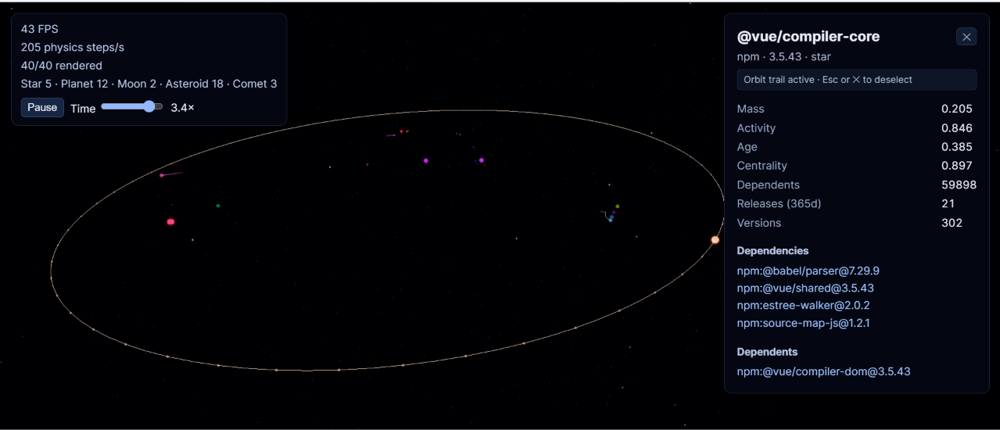
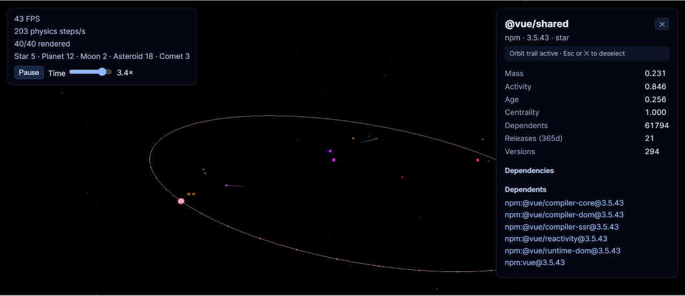
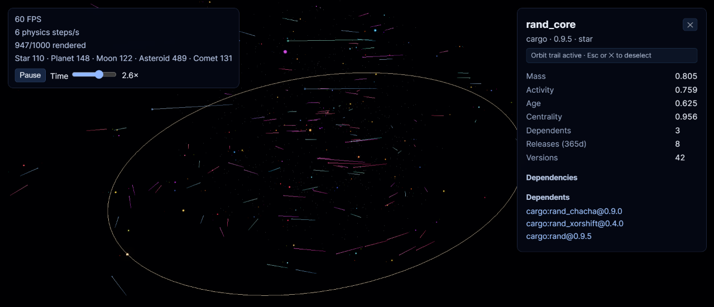
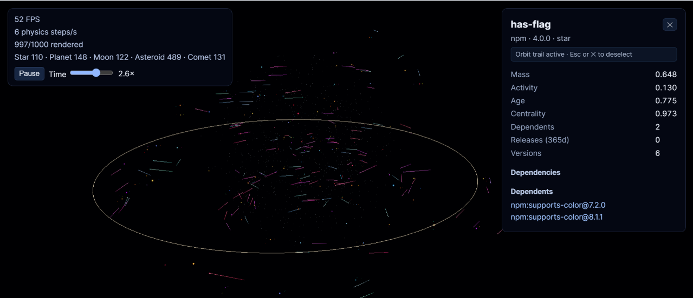

# Software Universe (V1)

Software packages as celestial bodies: deps.dev v3 data becomes a deterministic N-body universe rendered with Three.js.

## Images






## Quick start

```bash
npm install
npm run pipeline   # collect → params → classify
npm run dev        # open the URL printed by Vite
```

For an offline Stage 1 collector check, run `npm run collect:mock`. `npm run collect:smoke` fetches five real seeds and creates a small (~40 body) dataset. Raw API responses are cached in `data/raw/`; pass `--refresh` to the collector to refresh them.

## Architecture


The preprocessing stages own all derived physics values. The renderer only maps completed `{ celestialType, physics }` values to visual scale, brightness, and ecosystem-tinted color; those render characteristics are deliberately not persisted in JSON.

## Pipeline formulas

- `mass`: `log1p(dependentCount ?? crawlDependentCount)`, then tie-stable percentile normalization.
- `activity`: `log1p(releasesLast365d + releasesLast90d)`, then percentile normalization. The 90-day window is the recency boost.
- `age`: elapsed years from `firstPublishedAt` to `meta.generatedAt`, then percentile normalization. Missing dates are logged and assigned neutral `0.5`.
- `centrality`: fixed-iteration PageRank (damping `0.85`) along importer → dependency links, so importance flows toward dependencies. Cycles and isolated/dangling bodies are handled deterministically.

Classifier order is strict: star, comet, planet, moon, asteroid. A moon is a low-precedence body depended on by star/planet bodies, provided they make up at least `thresholds.moonParentShare` of all its dependents. Its heaviest qualifying parent wins (id breaks ties) and is stored as `parentId`.

## Simulation and rendering

Simulation uses visual units rather than real astronomical units: world distance units, simulation seconds, and unitless simulated mass. The sole physics tuning point is [`src/physics/constants.ts`](src/physics/constants.ts): `G = 0.3`, softening `1.1`, Barnes–Hut `θ = 0.5`, `dt = 1/60`, and simulated mass `1 + 18 × normalizedMass²`. Initial stars occupy a broad co-rotating disk, while deterministic hashing distributes primary bodies between them; this keeps separate visual solar systems from collapsing into one anchor.

The worker holds all simulation position, velocity, acceleration, and mass arrays. It advances with a 60 Hz accumulator and velocity Verlet. After each drift it applies a deterministic, mass-weighted non-penetration solver with a low-restitution bounce, so simulation bodies may touch but never overlap. Snapshot positions and velocities travel to the main thread as transferable `ArrayBuffer`s; the renderer returns old buffers for reuse, without `SharedArrayBuffer`.

There is exactly one `InstancedMesh` for each celestial type. LOD is presentation-only: frustum and distance culling can hide or simplify a body, but never stops its N-body integration. Every package receives a stable id-seeded natural color with only a subtle ecosystem tint. Comets use an instanced rocky nucleus plus shared gas-coma points and shared recent-position line trails. Stars add point lights and bloom.

## Tuning knobs

`config/universe.config.json` is the source of crawl and classification thresholds:

- `crawl.maxNodes`, `concurrency`, `fetchDependents`
- `thresholds.star`, `cometActivity`, `planetMass`, `moonParentShare`

The checked-in 40-body smoke universe produces 5 stars, 3 comets, 12 planets, 2 moons, and 18 asteroids. Five stars are 12.5%, slightly above the 3–10% guideline but retained because lowering the count to four removes all valid moon relationships in this small graph. A full collection has a different distribution; increase `thresholds.star` to make stars rarer. Physics constants are collected in `src/physics/constants.ts` as described above.

## Commands

```bash
npm run collect          # deps.dev v3 → public/data/universe.json
npm run params           # fill normalized physics parameters
npm run classify         # fill celestial types and moon parents
npm run pipeline         # collect → params → classify
npm run dev              # Vite development server
npm run build            # production build
npm run typecheck        # strict TypeScript check
npm test                 # unit tests
```

## Decisions and limitations

- The data source is an interface; the V1 implementation loads `/data/universe.json`. A future BigQuery-backed source can replace it without affecting physics or rendering.
- The graph schema stores edges as `source depends on target`; PageRank follows that direction to rank dependencies highly.
- Initial conditions are seeded from body ids. Stars occupy a small center cluster; planets and moons have approximate circular parent orbits; comets begin on eccentric trajectories; asteroids form a loose belt.
- Barnes–Hut approximates forces, and initial circular velocities do not account for every other body. The universe is intentionally visually stable rather than a precision astrophysics model.
- Only the current rendered positions are pickable by CPU ray/sphere testing; package edges are listed in the panel but are not drawn as scene lines.
- V1 targets roughly 100–400 bodies. It intentionally excludes WebGPU, SharedArrayBuffer, million-body optimization, spatial optimizations beyond Barnes–Hut, and interpolation between physics states.
