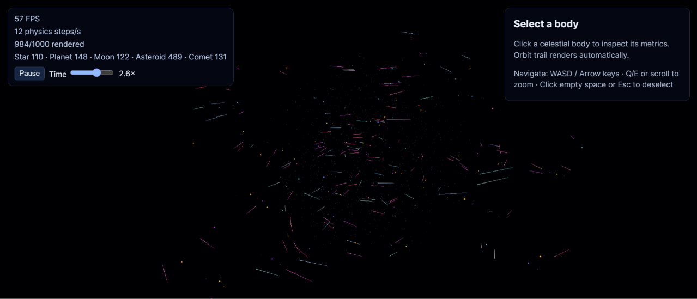
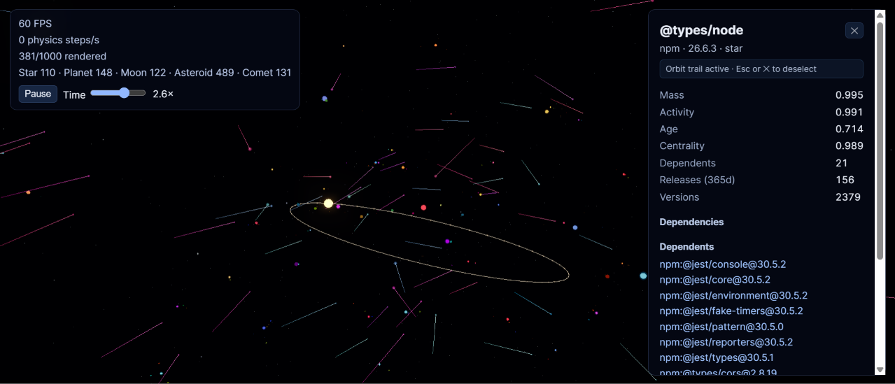
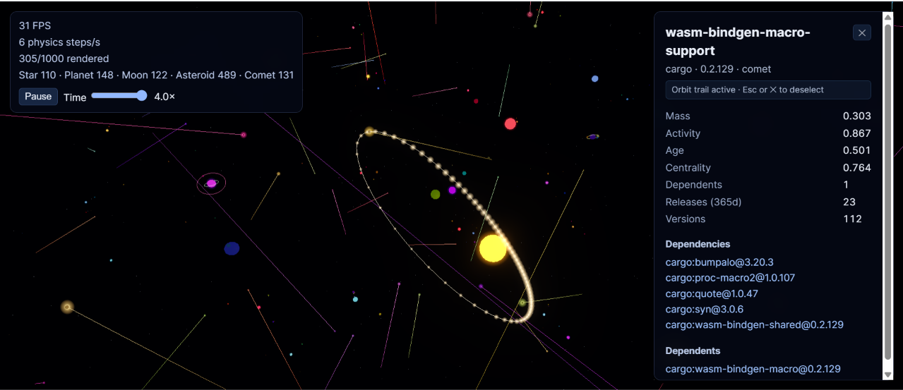
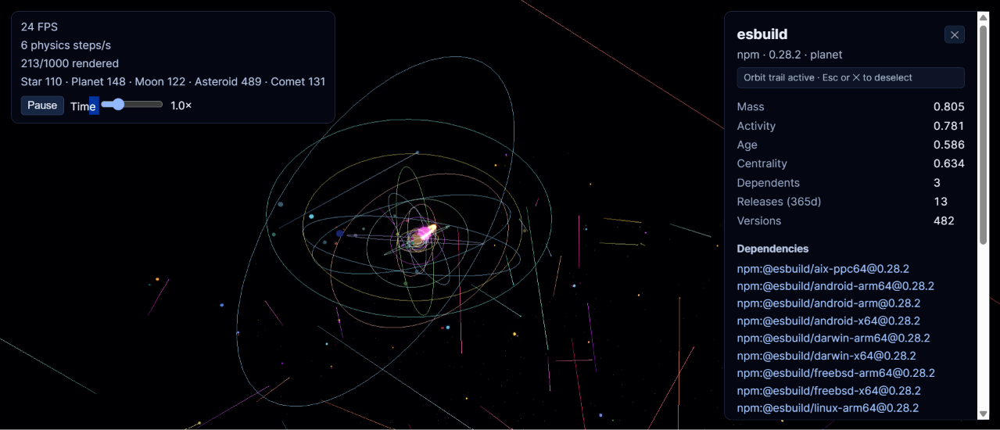
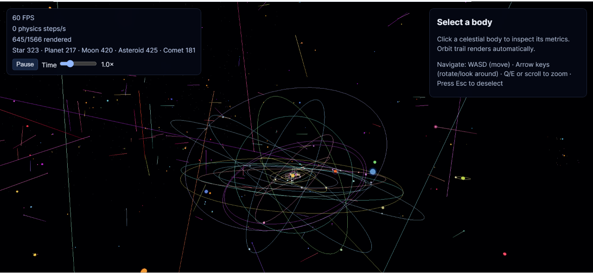

# Software Universe

[](https://nodejs.org/)
[](https://www.typescriptlang.org/)
[](https://vite.dev/)
[](https://threejs.org/)
[](https://github.com/privatenumber/tsx)
[](https://vitest.dev/)
[](https://www.npmjs.com/)

Software Universe turns package dependency data from [deps.dev](https://deps.dev/) into an interactive N-body galaxy. Packages become stars, planets, moons, comets, or asteroids, with dependency relationships represented by the generated universe data and package metadata shown in the interface.



## Features

- Collects package and dependency data from the deps.dev v3 API.
- Builds a deterministic universe dataset from configurable seed packages.
- Calculates package mass, activity, age, and graph centrality.
- Classifies packages as stars, planets, moons, comets, or asteroids.
- Simulates bodies with a Barnes–Hut N-body solver and velocity Verlet integration.
- Runs physics calculations in a Web Worker to keep rendering responsive.
- Renders celestial bodies with Three.js instancing, level of detail, culling, lighting, bloom, and picking.
- Provides deterministic initial conditions, colors, orbital trails, and comet motion.
- Displays package details, dependency information, and orbit trails in the UI.
- Includes mock collection, smoke collection, type checking, production builds, and automated tests.

## Screenshots






## Requirements

- Node.js 20 or newer
- npm

## Getting started

```bash
npm install
npm run pipeline
npm run dev
```

Open the local URL printed by Vite. The pipeline collects data, calculates physics parameters, and classifies the celestial bodies before the app loads the generated universe.

For a local data-only check without network requests, run:

```bash
npm run collect:mock
```

For a small real-data dataset, run:

```bash
npm run collect:smoke
npm run params
npm run classify
```

Raw API responses are cached in `data/raw/`. Use the collector's `--refresh` option when fresh responses are required.

## Data pipeline

```text
Seed packages → deps.dev collector → universe dataset → physics parameters → celestial classification → Three.js renderer
```

The browser loads the completed `public/data/universe.json` dataset. The preprocessing commands produce the graph, normalized package metrics, celestial types, and parent relationships used by the renderer.

## Project structure

```text
config/       Seed packages and universe configuration
scripts/      Collection, enrichment, parameter, and classification pipeline
shared/       Types shared by scripts and the browser
src/data/     Universe data loading
src/physics/  Worker-based N-body simulation
src/render/   Three.js scene and render characteristics
src/ui/       Interface and package details panel
tests/        Physics, classification, rendering, and pipeline tests
public/       Static assets and generated universe data
```

## Commands

```bash
npm run collect          # Collect deps.dev data into the universe dataset
npm run collect:smoke    # Collect a small real-data dataset
npm run collect:mock     # Run the collector with mock data
npm run params           # Calculate normalized physics parameters
npm run classify         # Assign celestial types and moon parents
npm run pipeline         # Run collect, params, and classify
npm run dev              # Start the Vite development server
npm run build            # Create the production bundle in dist/
npm run typecheck        # Run the strict TypeScript check
npm test                 # Run the test suite
```

## Deployment

The production app is a static Vite site. Run the data pipeline before building whenever the deployed universe should contain newly collected data.

### Build locally

```bash
npm ci
npm run pipeline
npm run build
```

Deploy the generated `dist/` directory with any static hosting provider.

### Vercel

Create a Vercel project connected to the repository with these settings:

```text
Build command: npm run pipeline && npm run build
Output directory: dist
Install command: npm ci
```

### Netlify

Create a Netlify site connected to the repository and configure:

```text
Build command: npm run pipeline && npm run build
Publish directory: dist
```

### GitHub Pages

For a project site, build with the repository name as Vite's base path:

```bash
npm ci
npm run pipeline # If you want fresh data set
npm run build -- --base=/REPOSITORY_NAME/
```

Publish the resulting `dist/` directory using GitHub Actions or the GitHub Pages deployment workflow. Replace `REPOSITORY_NAME` with the repository name, including the surrounding slashes. For a user or organization site hosted at the root domain, use `--base=/` instead.

> [!NOTE] 
> `npm run pipeline` is **not** required for any of the deployments above. The data is already included in `public/data/universe.json`. Only run the pipeline if you want to generate a fresh set of data. To skip it, use `npm run build` alone as the build command.

## Configuration

Edit `config/seed-packages.json` to change the packages collected by the pipeline. Collection limits, concurrency, dependent fetching, and classification thresholds are configured in `config/universe.config.json`.

## License

See [LICENSE](LICENSE)

